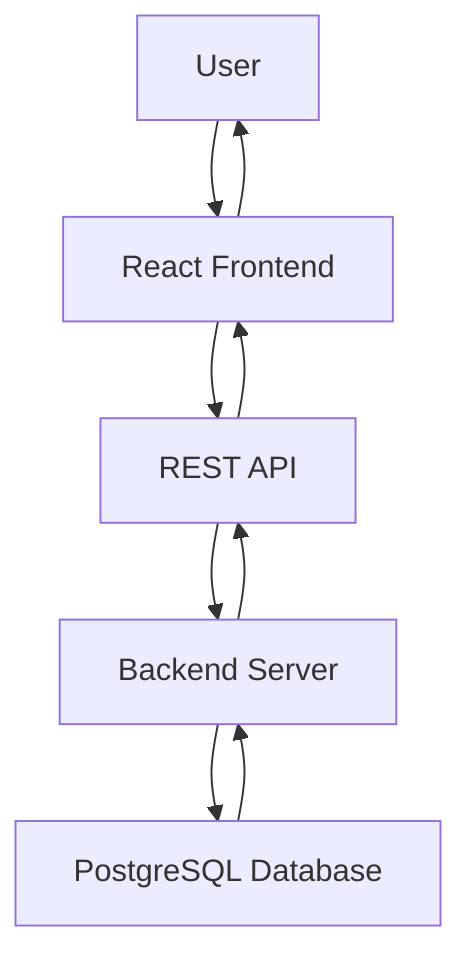

# System Architecture - Task Management App

## Overview

The application follows a three-tier architecture.

## Architecture Diagram

## Components

### 1. Frontend
- React
- Displays the user interface.
- Allows users to manage tasks.

### 2. Backend
- Node.js and Express.
- Handles business logic.
- Provides REST API endpoints.
- Validates incoming requests.

### 3. Database
- PostgreSQL.
- Stores tasks, categories and projects.

## Communication

The frontend communicates with the backend through REST API requests.
The backend reads and writes data in PostgreSQL.
