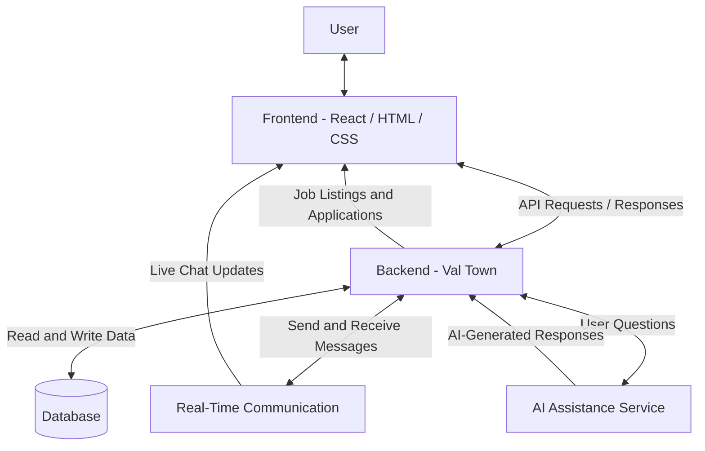

# System Architecture – Real-Time Job Board with Chat-Based Assistance

## 1. Architecture Overview

The application follows a client-server architecture. The frontend provides a user-friendly interface for browsing job listings, submitting job applications, creating assistance requests, and communicating through real-time chat.

The backend handles business logic, user authentication, job management, application processing, and communication between the frontend, database, and AI assistance service.

The database stores user information, job listings, applications, conversations, and messages.

The system also includes an AI-powered assistance component that helps users with questions and provides guidance through a chat-based interface.

## 2. Main Components

### Frontend

- Provides the user interface for the job board application.
- Allows users to register and log in.
- Displays available job listings.
- Allows job seekers to submit applications.
- Provides a section for creating and managing assistance requests.
- Displays real-time chat conversations.
- Communicates with the backend through API requests.

**Suggested technology:** React / HTML / CSS / JavaScript

### Backend

- Handles incoming API requests.
- Manages user authentication and authorization.
- Processes job listings and job applications.
- Creates and manages assistance requests.
- Handles conversation and message management.
- Validates user input.
- Communicates with the database.
- Connects the application to the AI assistance service.

**Suggested technology:** Val Town server functions / JavaScript

### Database

- Stores registered users and their information.
- Stores job listings and application records.
- Maintains relationships between users, jobs, and applications.
- Stores conversations and chat messages.
- Persists assistance requests.
- Maintains timestamps and message statuses.

**Suggested technology:** Val Town-supported persistent database

### Real-Time Communication Service

- Handles communication between users and the chat interface.
- Sends and receives messages.
- Updates conversations when new messages arrive.
- Maintains communication between connected users.
- Supports real-time assistance interactions.

**Suggested technology:** WebSockets or a supported real-time messaging solution

### AI Assistance Service

- Receives user questions and assistance requests.
- Analyzes user input.
- Generates helpful responses.
- Provides guidance related to job searching and applications.
- Returns AI-generated responses to the backend or chat interface.

**Suggested technology:** External AI API

## 3. High-Level System Diagram

## 4. Main Data Flow

1. The user opens the job board application through the frontend.
2. The frontend displays job listings, assistance requests, and chat sections.
3. The user can register or log in to access the application.
4. When a user submits a job listing, application, or assistance request, the frontend sends an API request to the backend.
5. The backend validates the submitted information and processes the request.
6. The backend stores the information in the database.
7. When a user sends a chat message, the message is processed and stored.
8. The real-time communication service delivers new messages to the appropriate conversation.
9. When a user asks the AI assistant a question, the backend sends the request to the AI assistance service.
10. The AI service generates a response and returns it to the application.
11. The frontend displays the updated information and chat responses to the user.

## 5. Architectural Constraints

- The frontend and backend communicate through defined API endpoints.
- The database is accessed through the backend or supported server functions.
- User passwords must be stored securely using password hashing.
- Authentication and authorization must protect private user information.
- Chat messages should be stored to preserve conversation history.
- Real-time communication depends on the availability of the selected messaging technology.
- AI assistance depends on the availability of the external AI service.
- API credentials and environment variables must be stored securely.
- User input must be validated before processing.
- The initial version focuses on a simple, maintainable architecture rather than unnecessary complexity.
- The application must support both desktop and mobile devices.

## Conclusion

The proposed architecture provides a foundation for a Real-Time Job Board with Chat-Based Assistance application.

It combines job management, user applications, persistent data storage, real-time communication, and AI-powered assistance in one system.

The modular structure allows the application to be maintained, tested, and expanded with additional features in the future.