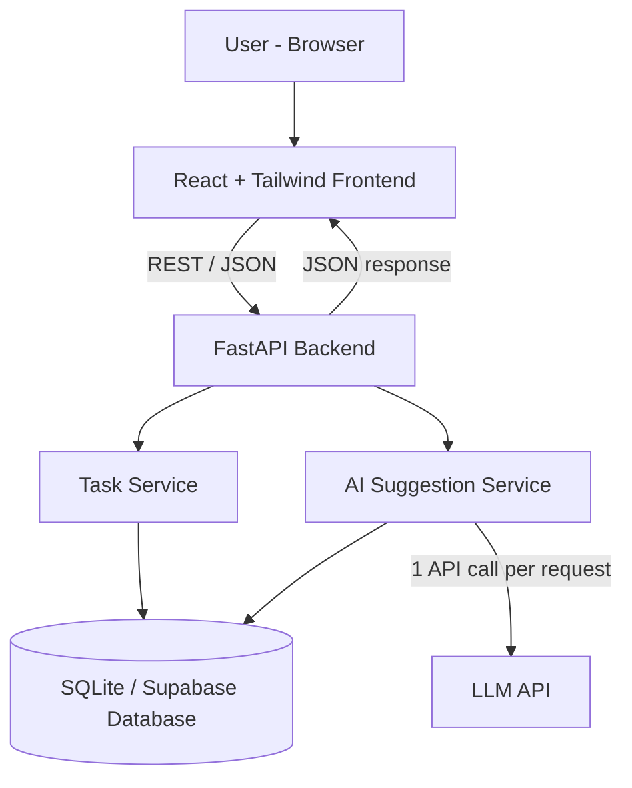

# System Architecture - TaskFlow: AI-Assisted Task Manager

## Overview

TaskFlow uses a simple three-tier architecture (frontend, backend API, database) plus one
external LLM service for priority suggestions. The stack matches the constraints in
`mvp_concept.md`: a 2-week sprint, one developer, no authentication and low cost.

## Architecture Diagram

## Components

### 1. Frontend (React + Tailwind CSS)
- Responsive single-page web app (no native mobile app).
- Task list with create, edit, delete, status change, filters and search.
- Dashboard with progress percentage, overdue/due-today highlights and the AI top 3.
- Talks to the backend only through REST calls.

### 2. Backend (FastAPI, Python)
- Exposes the REST API and validates all input (Pydantic models).
- **Task Service:** CRUD, filtering, search, progress calculation and the 500-task limit.
- **AI Suggestion Service:** selects open tasks, builds one prompt, calls the LLM once, parses the ranked result.
- Returns clear error messages (for example, when the LLM is unavailable) without breaking task features.

### 3. Database (SQLite for local use, Supabase/PostgreSQL if hosted)
- Stores projects, tasks and AI suggestion history.
- Single-user data model, so no user table.

### 4. External Service (LLM API)
- Called only when the user asks for suggestions, one call per request, to keep costs low.
- The API key is stored in a backend environment variable and never sent to the frontend.

## REST API Endpoints

| Method | Endpoint | Purpose |
|---|---|---|
| GET | /api/tasks | List tasks (query: status, priority, due_date, project_id, q) |
| POST | /api/tasks | Create a task |
| PUT | /api/tasks/{id} | Edit a task |
| PATCH | /api/tasks/{id}/status | Change status |
| DELETE | /api/tasks/{id} | Delete a task |
| GET | /api/stats | Progress percentage, overdue and due-today counts |
| POST | /api/suggestions | Ask the AI for the top 3 tasks for today |
| GET | /api/projects | List projects |
| POST | /api/projects | Create a project |

## Data Flow: AI Priority Suggestions

1. The user clicks "Suggest my top 3".
2. The frontend sends `POST /api/suggestions`.
3. The backend loads open tasks (not Done) from the database.
4. The backend sends one prompt with titles, deadlines and priorities to the LLM.
5. The LLM returns a ranking with short reasons.
6. The backend saves the result and returns the top 3 to the frontend.

## Design Decisions and Trade-offs

- **FastAPI over Node/Express:** fast to build, automatic validation and docs, and it works well with Python LLM SDKs.
- **SQLite first:** zero setup for a 2-week sprint, and it can move to Supabase later because the schema is standard SQL.
- **No authentication:** keeps the MVP small; adding login later means adding a user table and a user_id column.
- **Backend-only LLM calls:** protects the API key and allows cost control.

## Non-Functional Requirements

- **Scale:** up to 500 tasks per user, so no caching or pagination infrastructure is needed.
- **Performance:** task operations should respond in under 500 ms, and AI suggestions in under 10 seconds.
- **Reliability:** if the LLM fails, show an error and keep every other feature working.
- **Security:** validate all input, keep secrets in environment variables and enable CORS only for the frontend origin.
