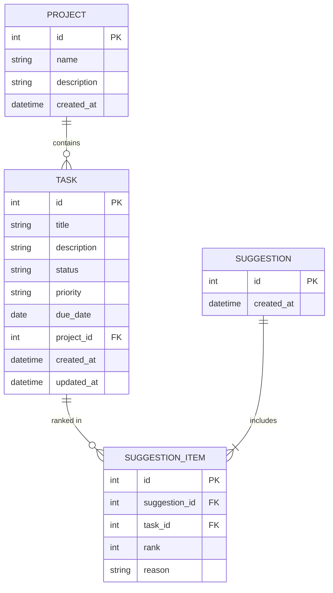

# Data Model - TaskFlow: AI-Assisted Task Manager

The model supports the five core features in `mvp_concept.md`. It is single-user, so there is no
user table. Types are written in generic SQL terms and work in both SQLite and PostgreSQL (Supabase).

## Entity Relationship Diagram

## Entity 1: Project

Optional grouping of tasks (for example, a client or a course).

| Field | Type | Constraints | Description |
|---|---|---|---|
| id | Integer | Primary key, auto-increment | Unique identifier |
| name | String(100) | Required | Project name |
| description | Text | Optional | Project details |
| created_at | DateTime | Default: now | Creation time |

## Entity 2: Task

Supports task CRUD, status tracking, filtering, search and deadline reminders.

| Field | Type | Constraints | Description |
|---|---|---|---|
| id | Integer | Primary key, auto-increment | Unique identifier |
| title | String(200) | Required | Short task name |
| description | Text | Optional | Task details |
| status | String | Required, one of `todo`, `in_progress`, `done`; default `todo` | Current status |
| priority | String | Required, one of `low`, `medium`, `high`; default `medium` | Importance |
| due_date | Date | Optional | Deadline, used for reminders and AI ranking |
| project_id | Integer | Foreign key to Project.id, nullable, ON DELETE SET NULL | Optional project |
| created_at | DateTime | Default: now | Creation time |
| updated_at | DateTime | Updated on every change | Last modification time |

## Entity 3: Suggestion

One record per AI suggestion request (one LLM call).

| Field | Type | Constraints | Description |
|---|---|---|---|
| id | Integer | Primary key, auto-increment | Unique identifier |
| created_at | DateTime | Default: now | When the suggestion was generated |

## Entity 4: Suggestion Item

The ranked tasks returned by a suggestion (up to 3 per request).

| Field | Type | Constraints | Description |
|---|---|---|---|
| id | Integer | Primary key, auto-increment | Unique identifier |
| suggestion_id | Integer | Foreign key to Suggestion.id, ON DELETE CASCADE | Parent suggestion |
| task_id | Integer | Foreign key to Task.id, ON DELETE CASCADE | Recommended task |
| rank | Integer | Required, 1 to 3 | Position in the top 3 |
| reason | Text | Optional | Short explanation from the AI |

## Relationships

- One Project can have many Tasks, and each Task belongs to zero or one Project.
- One Suggestion has many Suggestion Items (up to 3), and each Suggestion Item points to one Task.
- A Task can appear in many Suggestions over time.

## Derived Values (not stored)

- **Progress %** = (tasks with status `done` / total tasks) * 100.
- **Overdue** = `due_date` is before today and status is not `done`.
- **Due today** = `due_date` equals today and status is not `done`.

## Indexes

- `Task(status)`, `Task(priority)` and `Task(due_date)` for filtering.
- `Task(project_id)` for project views.

## Business Rules and Constraints

- The maximum is 500 tasks, enforced in the backend before insert.
- `title` cannot be empty, and `status` and `priority` are limited to the allowed values.
- Deleting a Project keeps its tasks (their `project_id` becomes null).
- Deleting a Task also deletes its Suggestion Items.
