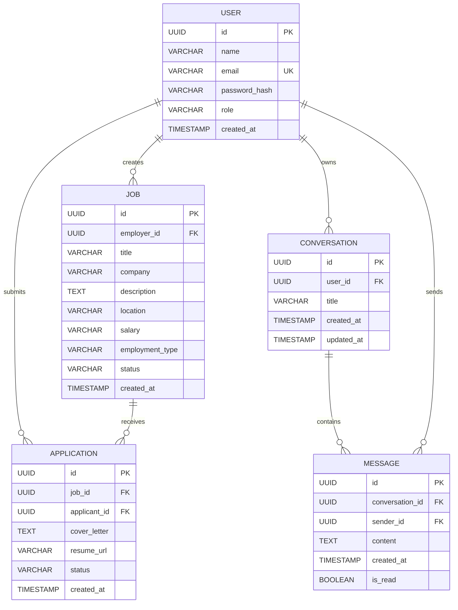

# Data Model – Real-Time Job Board with Chat-Based Assistance

## 1. Overview

The application uses a relational database to store users, job listings, applications, conversations, and messages.

The data model consists of five main entities:

1. User
2. Job
3. Application
4. Conversation
5. Message

The database supports user registration, job posting, job applications, assistance requests, and real-time communication.

## 2. Entities and Attributes

### Entity 1 – User

Stores information about registered users.

| Attribute | Data Type | Description |
|---|---|---|
| id | UUID | Primary key |
| name | VARCHAR(100) | User's full name |
| email | VARCHAR(255) | User's unique email address |
| password_hash | VARCHAR(255) | Hashed password |
| role | VARCHAR(20) | User role (job seeker, employer, admin) |
| created_at | TIMESTAMP | Account creation date |

### Entity 2 – Job

Stores job listings created by employers.

| Attribute | Data Type | Description |
|---|---|---|
| id | UUID | Primary key |
| employer_id | UUID | Foreign key referencing User |
| title | VARCHAR(150) | Job title |
| company | VARCHAR(150) | Company name |
| description | TEXT | Job description |
| location | VARCHAR(150) | Job location |
| salary | VARCHAR(100) | Salary information |
| employment_type | VARCHAR(50) | Full-time, part-time, or remote |
| status | VARCHAR(20) | Job status |
| created_at | TIMESTAMP | Job creation date |

### Entity 3 – Application

Stores applications submitted by job seekers.

| Attribute | Data Type | Description |
|---|---|---|
| id | UUID | Primary key |
| job_id | UUID | Foreign key referencing Job |
| applicant_id | UUID | Foreign key referencing User |
| cover_letter | TEXT | Application message |
| resume_url | VARCHAR(255) | Resume file URL |
| status | VARCHAR(30) | Pending, accepted, or rejected |
| created_at | TIMESTAMP | Application submission date |

### Entity 4 – Conversation

Stores conversations between users.

| Attribute | Data Type | Description |
|---|---|---|
| id | UUID | Primary key |
| user_id | UUID | Foreign key referencing User |
| title | VARCHAR(150) | Conversation title |
| created_at | TIMESTAMP | Conversation creation date |
| updated_at | TIMESTAMP | Last update date |

### Entity 5 – Message

Stores messages exchanged in conversations.

| Attribute | Data Type | Description |
|---|---|---|
| id | UUID | Primary key |
| conversation_id | UUID | Foreign key referencing Conversation |
| sender_id | UUID | Foreign key referencing User |
| content | TEXT | Message content |
| created_at | TIMESTAMP | Message timestamp |
| is_read | BOOLEAN | Message read status |

## 3. Entity Relationships

- **User → Job:** One user (employer) can create multiple job listings. Each job belongs to one employer (one-to-many).
- **User → Application:** One user can submit multiple job applications. Each application belongs to one applicant (one-to-many).
- **Job → Application:** One job can receive multiple applications. Each application belongs to one job (one-to-many).
- **User → Conversation:** One user can have multiple conversations (one-to-many).
- **Conversation → Message:** One conversation can contain multiple messages (one-to-many).
- **User → Message:** One user can send multiple messages (one-to-many).

## 4. Relationship Diagram

## 5. Data Integrity Rules

- Each user must have a unique email address.
- Every job listing must belong to an existing employer.
- Every application must reference an existing job and applicant.
- A user cannot submit multiple applications for the same job.
- Every conversation must belong to an existing user.
- Every message must belong to an existing conversation.
- Every message sender must reference an existing user.
- Required fields cannot contain NULL values.
- User passwords must be stored as secure hashes.
- Deleting a job should also handle its related applications according to the database deletion policy.
- Deleting a conversation should also handle its associated messages.
- Timestamps must record the creation and update dates of records.

